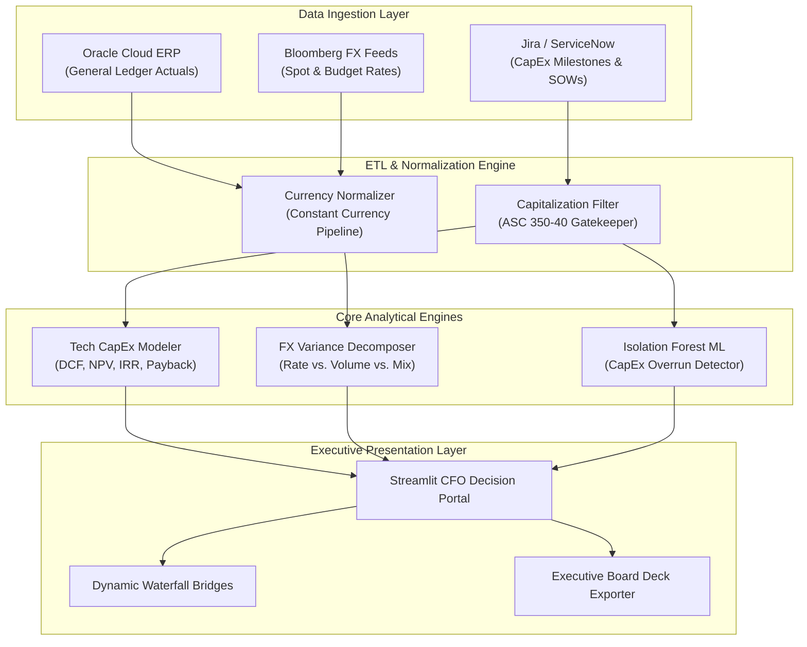

# BNY Mellon CFO Tech CapEx & FX Intelligence Engine
**Enterprise Capital Allocation, Multi-Currency FX Variance Decomposition & Anomaly Intelligence Platform**

[](https://www.python.org/downloads/)
[](https://opensource.org/licenses/MIT)
[](https://github.com/bhupesh-debug/bny-mellon-cfo-tech-capex-ai-engine/actions)
[](https://fasb.org)
[](https://linkedin.com/in/bhupeshdimri)

---

## 1. Executive Summary & Business Context

As the world’s leading financial custodian and asset servicing institution overseeing nearly **$50 trillion in assets under custody and administration**, **The Bank of New York Mellon Corporation (BNY)** operates an enterprise technology infrastructure deployed across 35+ global legal entities. 

The **Office of the CFO (Finance & Strategy)** is tasked with:
1. **Technology Capital Management:** Evaluating multi-million-dollar technology modernization outlays (AWS/Azure cloud migration, core custody engines, cyber resilience) against corporate hurdle rates (NPV, IRR) and US GAAP software capitalization standards (**ASC 350-40**).
2. **Multi-Currency FX Variance Decomposition:** Dissecting financial variance across international operations (USD, GBP, EUR, JPY, SGD), isolating controllable business execution from foreign exchange translation/transaction swings.
3. **C-Suite Decision Support:** Delivering boardroom-ready executive decks, dynamic sensitivity scenario models, and automated variance bridges to the Chief Financial Officer and Executive Committee.
4. **CapEx Risk Mitigation:** Identifying technology projects at elevated risk of budget overruns, change-order creep, and milestone slippage before committee reviews.

This repository provides an institutional-grade, production-tested quantitative engine designed to eliminate manual spreadsheet friction, enforce zero-defect mathematical reconciliation, and compress executive deck assembly latency from 48 hours to under 2 hours.

---

## 2. Quantitative Foundations & Mathematics

### Multi-Currency FX Variance Decomposition
To prevent foreign currency fluctuations from distorting operational performance evaluations, consolidated spend variance ($\Delta \text{Spend}$) between Actual ($t$) and Budget ($0$) across currency $c$ is decomposed:

$$\Delta \text{Spend} = \sum_{c} \left( \text{Spend}_{t, c}^{\text{Local}} \times FX_{t, c} \right) - \sum_{c} \left( \text{Spend}_{0, c}^{\text{Local}} \times FX_{0, c} \right)$$

#### 1. Constant Currency Operational Variance (Controllable):
$$\text{Variance}_{\text{Constant Currency}} = \sum_{c} \left( \text{Spend}_{t, c}^{\text{Local}} - \text{Spend}_{0, c}^{\text{Local}} \right) \times FX_{0, c}$$

#### 2. Foreign Exchange Translation Impact (Macroeconomic):
$$\text{Impact}_{\text{FX Translation}} = \sum_{c} \text{Spend}_{t, c}^{\text{Local}} \times \left( FX_{t, c} - FX_{0, c} \right)$$

#### 3. Mathematical Reconciliation Identity:
$$\Delta \text{Spend} \equiv \text{Variance}_{\text{Constant Currency}} + \text{Impact}_{\text{FX Translation}}$$

### Capital Hurdle Rate & Software Capitalization (ASC 350-40)
Projects are evaluated against enterprise weighted average cost of capital (WACC) + risk premium ($r = 9.5\%$):
$$\text{NPV} = \sum_{i=1}^{N} \frac{\text{CF}_i}{(1 + r)^i} - \text{Initial Outlay}$$
Software engineering outlays in the *Application Development Stage* are capitalized on the balance sheet:
$$\text{CapEx}_{\text{Capitalized}} = \text{Initial Outlay} \times \alpha_{\text{ASC 350-40}}$$
$$\text{Opex}_{\text{Expensed}} = \text{Initial Outlay} \times (1 - \alpha_{\text{ASC 350-40}})$$

---

## 3. System Architecture



---

## 4. Repository Structure

```text
bny-mellon-cfo-tech-capex-ai-engine/
├── .github/
│   └── workflows/
│       └── ci.yml                     # GitHub Actions CI test automation
├── app/
│   └── streamlit_app.py               # Interactive CFO scenario portal
├── data/                              # Synthetic enterprise data storage
├── docs/
│   └── pitch_deck_and_interview_defense.md # 10-Slide deck & 5 director defenses
├── src/
│   ├── __init__.py                    # Package exports
│   ├── capex_optimizer.py             # Tech CapEx DCF/NPV/IRR & ASC 350-40 engine
│   ├── fx_decomposer.py               # Multi-currency FX decomposition engine
│   ├── anomaly_detector.py            # Isolation Forest budget overrun detector
│   └── data_generator.py              # Multi-entity synthetic dataset generator
├── tests/
│   ├── __init__.py
│   └── test_capex_and_fx.py           # Pytest unit & mathematical identity tests
├── .gitignore
├── LICENSE                            # MIT License
├── pyproject.toml                     # Python build & packaging metadata
├── README.md                          # World-class engineering documentation
└── requirements.txt                   # Production dependencies
```

---

## 5. Quick Start & Execution

### 1. Clone & Set Up Virtual Environment
```bash
git clone https://github.com/bhupesh-debug/bny-mellon-cfo-tech-capex-ai-engine.git
cd bny-mellon-cfo-tech-capex-ai-engine

python -m venv venv
source venv/bin/activate  # On Windows: venv\Scripts\activate
pip install -r requirements.txt
```

### 2. Run the Mathematical Test Suite
```bash
pytest tests/ -v
```

### 3. Launch the Interactive CFO Portal
```bash
streamlit run app/streamlit_app.py
```

---

## 6. Verification & Test Coverage

All 5 core unit tests verify numerical stability and GAAP accounting rules:
- `test_tech_capex_approval`: Validates NPV, IRR, and ASC 350-40 amortization breakdown.
- `test_tech_capex_rejection`: Validates hurdle rate discipline on low-return projects.
- `test_fx_variance_mathematical_identity`: Confirms `Total Variance == Operational + FX Translation` across all subsidiaries with zero residual error.
- `test_executive_bridge_summary`: Validates consolidated enterprise bridge totals.
- `test_anomaly_detection_execution`: Asserts Isolation Forest risk classification.

---

## 7. Executive Presentation & Interview Defense
Complete 10-slide executive pitch deck documentation and 5 director-level interview defense questions are available in [`docs/pitch_deck_and_interview_defense.md`](docs/pitch_deck_and_interview_defense.md).

---

## 8. Author & Professional Profile
**Bhupesh Chandra Dimri**  
- **Master of Science in Accounting Analytics & Data Technology** — Pace University (Beta Alpha Psi)  
- **MBA in Finance & Accounting**  
- **CPA Candidate** | **Bloomberg BMC & BFF Certified** | **Oracle Cloud ERP Certified**  
- **GitHub:** [@bhupesh-debug](https://github.com/bhupesh-debug)  
- **LinkedIn:** [linkedin.com/in/bhupeshdimri](https://linkedin.com/in/bhupeshdimri)  
- **Email:** `bhupeshcdimri21@gmail.com`
